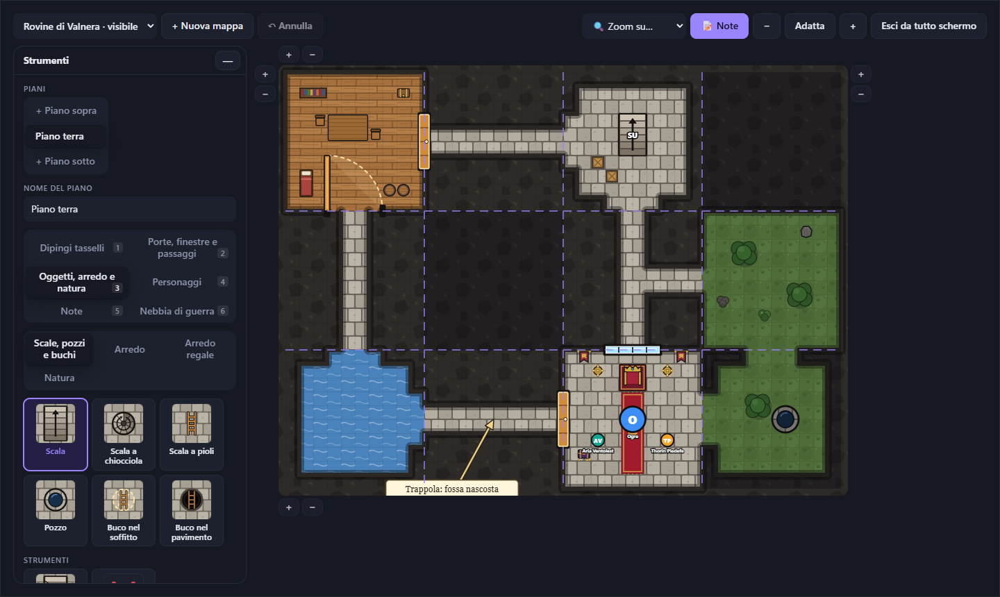
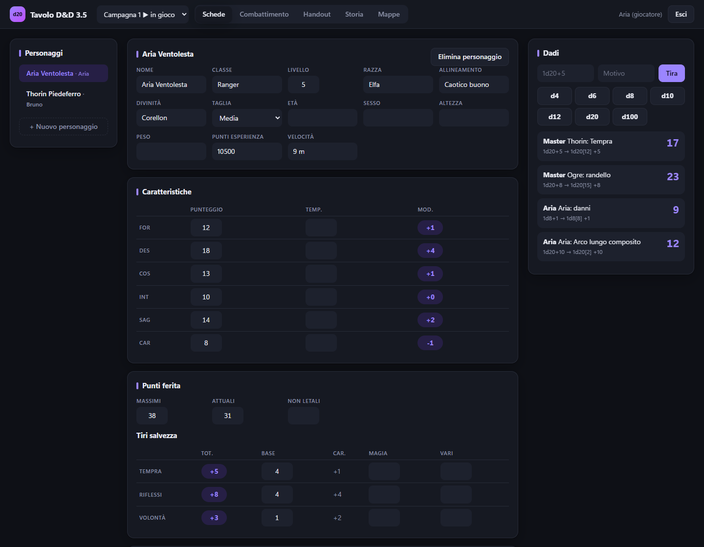
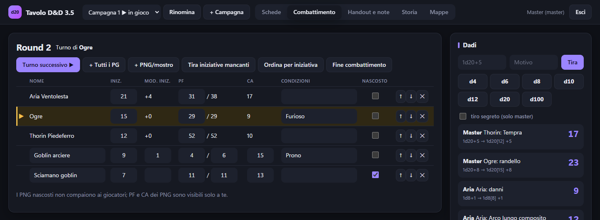
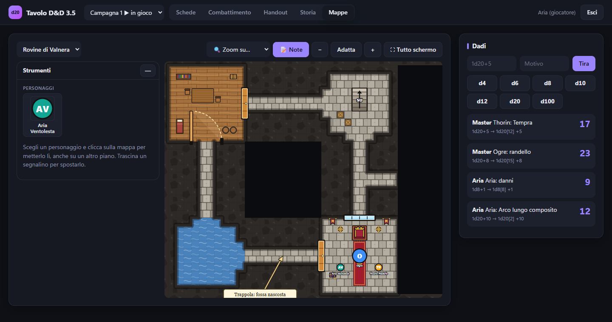
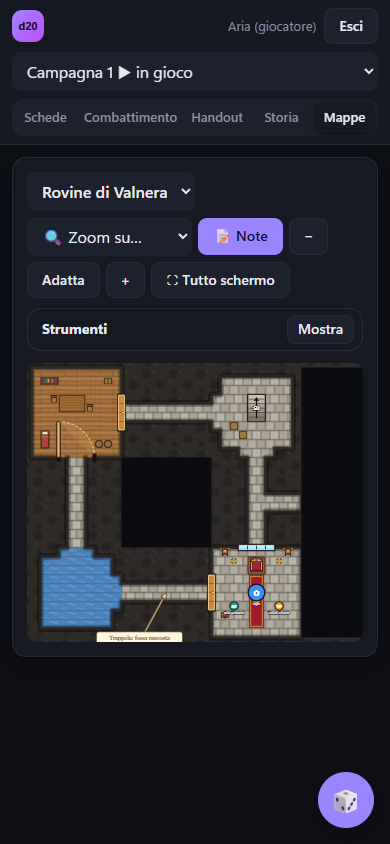

# Tavolo D&D 3.5

Tavolo virtuale per la rete di casa: schede dei personaggi, tracker di iniziativa, dadi condivisi, handout e mappe con nebbia di guerra. Non serve installare nulla.



| Scheda del personaggio | Combattimento (vista del master) |
| --- | --- |
|  |  |

| La stessa mappa vista da un giocatore | Dal telefono |
| --- | --- |
|  |  |

## Avvio

Doppio clic su **`TavoloDnD.exe`**: si apre una finestra con gli indirizzi e il browser va sul tavolo. Lascia la finestra aperta durante la partita; chiudendola il tavolo si spegne. L'exe contiene già Node, quindi puoi copiarlo su qualsiasi PC Windows; i dati vengono salvati in `data.json` **nella stessa cartella dell'exe**.

L'exe non è nel repository: va creato (vedi sotto) la prima volta su ogni computer e dopo ogni modifica a `server.js` o `index.html`.

Alla prima partenza la console stampa il **PIN del master** e gli indirizzi da dare ai giocatori (es. `http://192.168.1.20:3000`).
Per scegliere tu il PIN (o reimpostarlo): `$env:MASTER_PIN="1234"; .\TavoloDnD.exe` in PowerShell.

La prima volta Windows chiede di consentire TavoloDnD nel firewall: accetta per le **reti private**, altrimenti i giocatori non si collegano.

## Creare l'exe

Serve [Node.js](https://nodejs.org) (versione 22 o successiva) installato sul PC dove crei l'exe; chi poi usa l'exe non ne ha bisogno.

1. **Chiudi il tavolo** se è acceso (la finestra di TavoloDnD), altrimenti l'exe non si può sovrascrivere.
2. Apri PowerShell nella cartella del progetto (in Esplora file: clic destro sulla cartella → *Apri nel terminale*).
3. Lancia:
   ```
   npm run build
   ```
4. Alla fine compare `Creato TavoloDnD.exe`: il file è nella cartella del progetto, accanto a `data.json`.

La prima volta serve internet: il comando scarica da npm `postject`, lo strumento ufficiale di Node che inserisce il programma nell'exe. Durante la creazione compare l'avviso `warning: The signature seems corrupted!`: è normale (l'exe non è firmato) e si può ignorare.

Scorciatoia: `aggiorna.cmd` fa tutto da solo (scarica l'ultima versione da GitHub e crea l'exe).

Cosa succede dietro (`build.js`): Node impacchetta `server.js` e `index.html` in un blob, copia `node.exe` come `TavoloDnD.exe` e ci inserisce il blob. Per questo l'exe pesa circa 90 MB: contiene Node intero.

Per provare le modifiche senza ricreare l'exe: `npm start` (poi apri http://localhost:3000), e `npm test` per i controlli automatici.

## Lavorare su più computer

Il codice è in un repository git; `data.json` e `TavoloDnD.exe` restano fuori (i dati contengono account e PIN, l'exe si ricrea).

- **Su un nuovo computer** (servono [Git](https://git-scm.com) e [Node.js](https://nodejs.org)): `git clone <indirizzo del repository>`, poi doppio clic su `aggiorna.cmd` per creare l'exe.
- **Dopo aver modificato il codice**: `git add -A`, `git commit -m "cosa ho cambiato"`, `git push`.
- **Per prendere le modifiche fatte altrove**: chiudi il tavolo e fai doppio clic su `aggiorna.cmd` (scarica e ricrea l'exe).
- **Per spostare anche le partite**: copia a mano `data.json` accanto all'exe sull'altro PC.

## Uso

- **Giocatori**: aprono l'indirizzo, scelgono nome + PIN (l'account si crea al primo accesso), creano e compilano la propria scheda. Le schede altrui si vedono in sola lettura.
- **Master**: entra come `Master`; modifica tutte le schede, assegna una scheda a un giocatore, gestisce il combattimento (PNG nascosti, PF dei PNG visibili solo a lui), tira dadi segreti, scrive note private e pubblica handout.
- **Campagne**: in alto il master sceglie la campagna in gioco (▶), ne crea di nuove o la rinomina. Ogni campagna ha le sue schede, il suo combattimento, il suo log dei dadi, i suoi handout e le sue note; gli account restano gli stessi in tutte le campagne. I giocatori possono sfogliare le altre campagne e aggiornare lì i propri personaggi; quando il master cambia la campagna in gioco, tutti tornano su quella.
- **Mappe**: il master le disegna a tasselli di 15 m (fino a 40 per lato) con pennello, porte, finestre, scale, arredi e natura, anche su più piani (il piano sopra o sotto si può vedere in trasparenza). Le mostra ai giocatori quando vuole; i segnalini occupano lo spazio della taglia del personaggio, ognuno muove il suo. Le note con freccia e la **nebbia di guerra** si accendono e spengono dal master: ai giocatori arriva solo ciò che è stato rivelato. Scorciatoie: tasti 1–6 per gli strumenti, Ctrl+Z annulla, Ctrl+rotella zoom, clic destro cancella.
- I tiri si fanno cliccando sui bonus in scheda (TS, abilità, attacchi, caratteristiche) o dal pannello Dadi. Li tira il server, tutti vedono il log.

Tutto è salvato in `data.json` (fai una copia per il backup). Per ripartire da zero: ferma il server ed elimina `data.json`.
